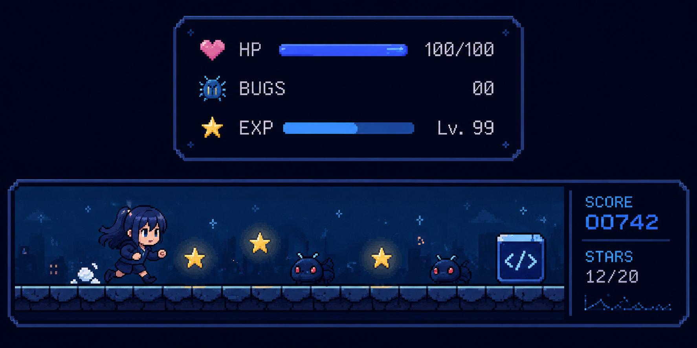

# Hi, I'm Jumanah! 👋🏻

  

Software Engineering Student at Umm Al-Qura University

> "We live in an era of scientific innovations, unprecedented technologies, and unlimited growth opportunities."
>
> — **His Royal Highness Mohammed bin Salman**

## 👩🏻‍💻 About Me

- 🎓 Software Engineering student at Umm Al-Qura University.
- 💻 Interested about web development and UI/UX design.
- 🎨 Interested in graphic design.
- 🌱 Always learning, experimenting, and growing as a developer.

<!-- Anime × Coding Mini Game -->

  

## 🤝 Connect With Me

  
  

## 🛠️ Tech Stack

  
  
  
  
  
  

## 🎯 Current Focus

- 🎓 Working on my graduation project.
- 🌐 Improving my web development skills.
- 🎨 Exploring UI/UX design and user-centered experiences.
- 🚀 Expanding my knowledge and applying what I learn through projects.

## 🍿 Fun Fact

I'm an anime lover! ✨ I balance creativity in code with the imagination of anime worlds, and always have room for one more episode.

## 🗝️ The Secret Room

🌙 *A mysterious room, three little puzzles, and a secret waiting to be discovered...*

🕵🏻‍♀️ Level 1 — Who Am I?

I appear when something goes wrong in your code.
Developers aren't happy to see me, but finding me is the first step to fixing the problem.

👀 What am I?

🍵 Need a little hint?

I'm not a person, but developers often spend hours looking for me!

✨ Reveal the answer

A **bug** 🐛

Keep this word in mind. You'll need it later.

🧩 Level 2 — Crack the Code

A secret message was found on the screen:

`JG DW WI`

Something shifted the letters.

💭 Hint: Each letter has moved **2 places forward** in the alphabet. Move each one back to decode the message.

🪄 Reveal the decoded message

`HE BU TG`

Hmm... that doesn't look right! Maybe the message was corrupted.

The important clue is the shifting technique itself: a **Caesar cipher** 🔐

🎮 Level 3 — The Logic Challenge

A little robot follows these instructions:

- 🍎 If the box contains an apple, it says "Yummy!"
- 🍌 If the box contains a banana, it says "Not bad!"
- 📦 The box contains neither fruit.

What should the robot say?

A) Yummy! 🍎

B) Not bad! 🍌

C) Nothing! 🤖

🌟 Reveal the answer

**C) Nothing!**

The robot checks conditions before deciding what to do.

In programming, this is called **conditional logic** 🧠

Keep exploring — the secret door is waiting!

🚪 The Secret Door

You found a bug 🐛, followed the clues 🔍, and solved the final riddle.

Now, what **7-letter programming term** describes the process of finding and fixing bugs?

🔓 Reveal the secret password

# DEBUGGING 🔑

🎉 You cracked the mystery!

*Every great developer starts by solving one bug at a time.*

---

  <i>"Curiosity creates possibilities."</i>

